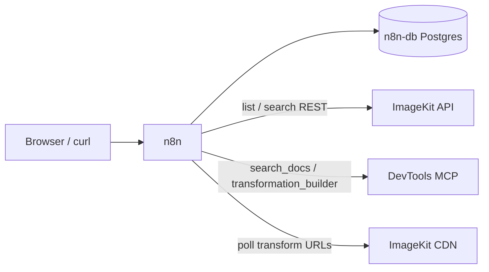

# Why deploy ImageKit workflows with n8n on Render?

[n8n](https://n8n.io) is an open-source workflow automation tool. Render already ships a plain [n8n template](https://github.com/render-examples/n8n) - “n8n on Render” isn’t the point here. This template ships **two ImageKit workflows already imported** on first boot: a media-library chat agent and a webhook-triggered batch transform that correctly waits out ImageKit’s async “200 means not done yet” behavior.

You get a production n8n instance on managed Postgres, with DevTools MCP wired for docs search and transformation URL building. After first login you add ImageKit and LLM credentials in n8n’s UI - no building the graphs from scratch.

[](https://render.com/deploy?repo=https://github.com/gitpichardo/n8n-render-workflow)

> The button provisions **n8n** + **Postgres** from [`render.yaml`](render.yaml), nested under an `n8n-imagekit` project (`production` environment). Plan is **standard** (starter OOMs n8n). After first login, add ImageKit + LLM credentials - see Next steps. Everything n8n needs is configured in the Blueprint, so there is no env group and no deploy ordering to worry about.

## Architecture



On first boot, `scripts/import-workflows.sh` runs `n8n import:workflow` for both files in `workflows/`, then starts n8n. A marker on the persistent disk skips re-import on later deploys so UI edits aren’t overwritten.

## What you can build

A ready n8n host with:

1. **`imagekit-library-chat`** - Chat with an AI agent that lists/searches your media library and custom metadata via ImageKit REST, and can search ImageKit docs via DevTools MCP.
2. **`imagekit-batch-transform`** - `POST` a search query + variants; it fans out asset × variant jobs (batch size **5**), builds transform URLs via MCP, polls until ready, returns a CSV manifest.

## Key features

- **Workflows pre-imported**: Both graphs land on first boot; no blank canvas.
- **Async poll done right**: Same rules as the creative-automation template - `is-intermediate-response`, video `302`, `202`, `ik-error`, jittered backoff.
- **Batch size 5**: Split In Batches caps in-flight transforms so a webhook can’t flood ImageKit.
- **DevTools MCP, not `execute`**: Public `search_docs` / `transformation_builder` only. Library access uses your private key on HTTP Request nodes - see [docs/v2-migration.md](docs/v2-migration.md) for the path to named hosted MCP tools.
- **One-click Blueprint**: n8n (Docker) + Postgres with host/webhook URL env vars wired via `fromService`.
- **Credentials stay in n8n**: ImageKit and LLM keys live in n8n’s encrypted store, not container env.

## Use cases

- Ops asks “how many approved hero images wider than 2000px?” in chat instead of writing API calls
- Marketing posts a webhook to generate square + wide crops and downloads a CSV of CDN URLs
- Agency forks the Blueprint as a reusable media-automation starter for client workspaces
- Team prototypes ImageKit transforms in n8n before promoting logic to a dedicated service

## What's included

| Service | Type | Purpose |
|---|---|---|
| `n8n` | Web Service (Docker) | n8n UI + webhooks; imports ImageKit workflows on first boot |
| `n8n-db` | PostgreSQL | Workflows, credentials, executions |

Workflows in `workflows/`:

| Workflow | Trigger | Purpose |
|---|---|---|
| `imagekit-library-chat` | Chat | Conversational agent over the media library |
| `imagekit-batch-transform` | Webhook | Search → fan-out → poll → CSV |

## Prerequisites

- **ImageKit Private Key**: From [API keys](https://imagekit.io/dashboard/developer/api-keys) (starts with `private_`). Used as HTTP Basic Auth **User** (password empty) in n8n.
- **Anthropic or OpenAI API key**: For the chat agent’s model node.
- **ImageKit account**: Free tier works for list/search and basic transforms. [Sign up](https://imagekit.io/registration/).

DevTools MCP (`https://devtools-mcp.imagekit.io/mcp`) needs no auth.

## Next steps

1. **Deploy** - Click Deploy to Render above (or New → Blueprint on a fork). Wait until logs show workflows imported (`marked workflows as imported`).
2. **Create the owner account** - Open the n8n URL and complete setup.
3. **Add credentials**
  - **Anthropic** (or swap the model node for OpenAI) on `imagekit-library-chat`.
  - **HTTP Basic Auth** for ImageKit on the three REST nodes: User = private key, Password = empty. Create once; reuse on the other nodes.
4. **Try chat** - Open `imagekit-library-chat` → **Open Chat**. Test data: make sure your [media library](https://imagekit.io/dashboard/media-library) has 3 or more images (upload a few if empty), then ask:
   - `What files do you have in the media library? List up to 5 with their file names.`
   - `How many files are tagged approved?` (tag one image `approved` first)
   - `What custom metadata fields exist on this account?`
5. **Try batch transform** - Activate `imagekit-batch-transform`, copy its **production** webhook URL, then run the request below. With 2 variants and `maxAssets: 5` you should get up to 10 rows (5 assets × 2 variants), each with a final CDN URL, in the downloaded `manifest.csv`.

```bash
curl -X POST https://<your-n8n-host>/webhook/imagekit-batch-transform \
  -H "Content-Type: application/json" \
  -d '{
        "searchQuery": "type=\"file\"",
        "maxAssets": 5,
        "variants": [
          { "name": "square", "query": "resize to 1080x1080 with focus on the face" },
          { "name": "wide", "query": "resize to 1600x900" }
        ]
      }' \
  --output manifest.csv
```

Inactive production webhooks return `"is not registered"` - flip the workflow toggle first.

### Auto-deploy note

Services created with a plain repo URL (API/CLI) do not auto-deploy on push. This repo’s [`.github/workflows/deploy.yml`](.github/workflows/deploy.yml) can redeploy via the Render CLI when `RENDER_API_KEY` is set as a GitHub secret. Blueprint + GitHub OAuth deploys auto-update normally.

### Disk note

A small 1 GB disk holds the import marker (and n8n’s local folder). Postgres holds real state. Drop the `disk:` block in `render.yaml` if you prefer re-importing on every deploy and zero-downtime deploys.

## Resources

- [n8n documentation](https://docs.n8n.io/)
- [Deploy n8n on Render](https://render.com/docs/deploy-n8n)
- [ImageKit build with AI / DevTools MCP](https://imagekit.io/docs/build-with-ai)
- [ImageKit transformations](https://imagekit.io/docs/transformations)
- [V2 MCP migration notes](docs/v2-migration.md)
- [Sister template: creative automation on Workflows](https://github.com/gitpichardo/creative-automation-workflow)

## License

MIT
