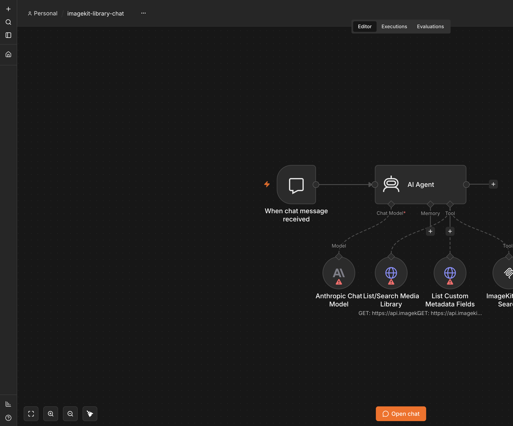
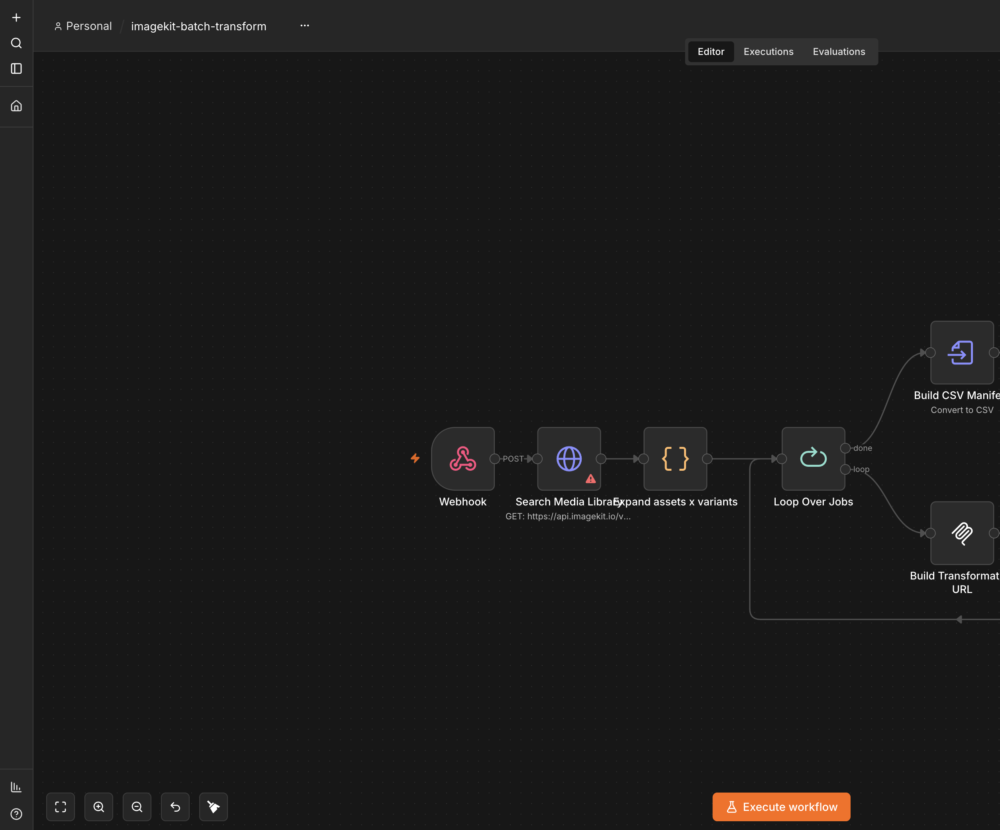

# imagekit-n8n-render

A Render Blueprint that deploys [n8n](https://n8n.io) with two ImageKit
workflows already imported and ready to run on first boot, wired to
[ImageKit's public DevTools MCP server](https://imagekit.io/docs/build-with-ai)
so the agent nodes have real media-library tools -- no manual workflow
building required.

Render already has an n8n template
([render-examples/n8n](https://github.com/render-examples/n8n)); "n8n on
Render" isn't the contribution here. The contribution is what ships inside
it: working agentic media automation that runs the moment the deploy
finishes.

[](https://render.com/deploy?repo=https://github.com/gitpichardo/n8n-render-workflow)

> The button provisions `n8n` + Postgres from [`render.yaml`](render.yaml).
> You will need an [ImageKit account](#imagekit-setup) (and an LLM key for
> the chat agent) after first login — see [First login setup](#first-login-setup).
> `autoDeployTrigger` is `off` so forks created from this button do not
> redeploy on every push to this template repo.

> **Status:** built against n8n's `execute`-free surfaces on purpose. See
> [docs/v2-migration.md](docs/v2-migration.md) for exactly what changes once
> ImageKit's hosted MCP ships named tools instead of `execute`.

## Architecture

Forks the shape of Render's own n8n Blueprint and adds an import layer:

| Service | Type | Purpose |
|---|---|---|
| `n8n` | Web service (Docker) | n8n instance with persistent disk |
| `n8n-db` | Postgres | n8n state (workflows, credentials, executions) |

On first boot, `scripts/import-workflows.sh` (the container's entrypoint)
imports the two workflows in `workflows/` before starting n8n normally:

```
n8n import:workflow --separate --input=/workflows
```

A marker file on the persistent disk (`$N8N_USER_FOLDER/.workflows-imported`,
default `/home/node/.n8n/.workflows-imported`) guards every boot after the
first, so a re-deploy never overwrites edits you made to these workflows in
the n8n UI.

### Why a persistent disk, when Render's own template skips it

[Render's n8n docs](https://render.com/docs/deploy-n8n) recommend Postgres
*over* a disk specifically because a disk blocks zero-downtime deploys and
multi-instance scaling. This repo uses Postgres for all of n8n's actual
state (workflows, credentials, executions) for exactly that reason, and adds
a *small* 1&nbsp;GB disk only so the marker file above survives a redeploy.
If you don't mind re-importing (harmlessly -- it's an upsert, not a wipe) on
every deploy, delete the `disk:` block from `render.yaml` and drop the
zero-downtime tradeoff.

## The workflows

### 1. `imagekit-library-chat.json` -- conversational agent over the media library

```
Chat Trigger
  -> AI Agent (Anthropic Claude by default)
       Tool: HTTP Request -> ImageKit list/search REST endpoint
       Tool: HTTP Request -> ImageKit custom metadata fields REST endpoint
       Tool: MCP Client Tool -> DevTools MCP (search_docs only)
```

Ask it things like *"how many files do we have tagged approved"*, *"find
hero images wider than 2000px"*, or *"what custom metadata fields exist on
this account"* and it answers by actually calling the ImageKit API rather
than guessing.

### 2. `imagekit-batch-transform.json` -- webhook-triggered batch renderer

```
Webhook  (POST { searchQuery, maxAssets?, variants: [{ name, query }] })
  -> HTTP Request: ImageKit search REST endpoint
  -> Code: fan out assets x variants
  -> Loop Over Jobs (Split In Batches, batch size 5)
       -> MCP Client -> DevTools MCP transformation_builder tool
       -> Code: poll until ImageKit finishes rendering (see below)
       -> (loops back)
  -> Convert to File (CSV)
  -> Respond to Webhook
```

The same creative-automation story as
[`imagekit-render-creative-automation`](../imagekit-render-creative-automation),
as a visual n8n workflow instead of a TypeScript service. Try it once
imported and credentialed:

```bash
curl -X POST https://<your-n8n-host>/webhook/imagekit-batch-transform \
  -H "Content-Type: application/json" \
  -d '{
        "searchQuery": "type=\"file\"",
        "maxAssets": 5,
        "variants": [
          { "name": "square", "query": "resize to 1080x1080 with focus on the face" },
          { "name": "wide", "query": "resize to 1600x900" }
        ]
      }' \
  --output manifest.csv
```

#### The completion check is the important part

ImageKit's long-running transformations (AI edits, upscaling, video) don't
fail loudly when they're not ready -- they can return a 200 with an
intermediate placeholder. `Poll transformation until ready` is a plain
`Code` node (not a visual polling loop, on purpose -- see the comment inside
the node) that implements the exact same rules as
[`imagekit-render-creative-automation/src/lib/await-transformation.ts`](../imagekit-render-creative-automation/src/lib/await-transformation.ts):

1. Never follow redirects automatically, and treat a 302 (ImageKit's
   first-request video behavior) as "not ready."
2. Treat the `is-intermediate-response: true` header as "not ready" even on
   a 200.
3. Treat a 202 as "not ready."
4. Retry with exponential backoff plus jitter, starting at 1s and capped at
   30s, up to a 2-minute overall budget.
5. Surface an `ik-error` response header as a hard failure, not a retry.

## MCP configuration

n8n's [MCP Client Tool node](https://docs.n8n.io/integrations/builtin/cluster-nodes/sub-nodes/n8n-nodes-langchain.toolmcp/)
(for AI Agents) and standalone
[MCP Client node](https://docs.n8n.io/integrations/builtin/core-nodes/n8n-nodes-langchain.mcpclient/)
(for regular workflow steps -- these are two different node types; see the
note on `Build Transformation URL` in `imagekit-batch-transform.json`) both
connect to an external MCP server over Streamable HTTP or SSE, with none,
Bearer, header, or OAuth2 auth.

**Default configuration in this repo:** the public
[ImageKit DevTools MCP](https://imagekit.io/docs/build-with-ai) at
`https://devtools-mcp.imagekit.io/mcp`, no authentication required, exposing
`search_docs` and `transformation_builder`. Everything that touches your own
library goes through plain HTTP Request nodes with your ImageKit private key
instead, because:

> Do not point any workflow at ImageKit's current `execute`-style API MCP.
> Handing an agent arbitrary code execution against a key-bearing SDK client
> is not something to ship in a public template, and that tool is being
> removed in ImageKit's V2 MCP release anyway.

Once ImageKit ships named tools on its hosted MCP, the tradeoff flips: swap
the placeholder HTTP Request (Tool) nodes for named MCP tools with a
**read-only-scoped** API key. Exactly which nodes and how is tracked in
[docs/v2-migration.md](docs/v2-migration.md) so the swap is mechanical
rather than archaeological.

## ImageKit setup

Yes — you need ImageKit credentials to use the media-library REST nodes
(list/search, custom metadata, batch transform search). The DevTools MCP
nodes (`search_docs`, `transformation_builder`) are public and need no key.

1. Create an account at [imagekit.io/registration](https://imagekit.io/registration/).
2. Open the [API keys dashboard](https://imagekit.io/dashboard/developer/api-keys)
   and copy your **Private key** (starts with `private_`).
3. After n8n is up, attach that key as an HTTP Basic Auth credential in the
   editor — see [First login setup](#first-login-setup). ImageKit keys are
   **not** set as container env vars in this Blueprint; they live in n8n's
   encrypted credential store.

You will also need an Anthropic or OpenAI API key for the chat agent
workflow (same first-login steps).

## First login setup

Two credentials can't be baked into the exported workflow JSON (n8n never
exports credential secrets, by design) and need to be created once, by hand,
after your first login:

1. **An LLM credential for the AI Agent in `imagekit-library-chat`.**
   Open the workflow, click the **Anthropic Chat Model** node (it imports
   with no credential attached and shows a warning triangle until you do
   this), and create an **Anthropic** credential with your API key. Prefer
   OpenAI instead? Delete that node, add an **OpenAI Chat Model** node, give
   it an **OpenAI** credential, and reconnect it to `AI Agent`'s model input
   the same way.
2. **An HTTP Basic Auth credential for ImageKit's REST API**, used by three
   nodes across both workflows (`List/Search Media Library`, `List Custom
   Metadata Fields`, `Search Media Library`). Open any one of them, choose
   **Create New Credential** under Authentication, and set:
   - **User:** your ImageKit **private** key (starts with `private_`)
   - **Password:** leave empty

   Create it once, then select the existing credential (by name) on the
   other two nodes instead of creating it three times.

The DevTools MCP nodes (`ImageKit Docs Search`, `Build Transformation URL`)
need **no credential** -- the endpoint is public and unauthenticated.

## Environment variables

```
N8N_ENCRYPTION_KEY        generateValue: true (render.yaml)
N8N_HOST                  from the web service's onrender.com hostname
N8N_PROTOCOL              https
WEBHOOK_URL               from the web service's full onrender.com URL
DB_TYPE                   postgresdb
DB_POSTGRESDB_*           from the Postgres service (render.yaml)
IMAGEKIT_MCP_URL           https://devtools-mcp.imagekit.io/mcp (public, no auth)
```

ImageKit's private key and any LLM API key are **not** container env vars in
this template -- they're n8n credentials created in the UI (see above), so
they live in n8n's own encrypted credential store rather than in plaintext
next to the process.

## Deploying to Render

1. Click the [Deploy to Render](https://render.com/deploy?repo=https://github.com/gitpichardo/n8n-render-workflow) button above, **or** fork this repo and in the Render dashboard use **New > Blueprint** pointed at your fork.
   Render provisions the `n8n` web service and `n8n-db` Postgres database
   from `render.yaml`.
2. Wait for the first deploy to finish building the Docker image and
   importing both workflows (check the service logs for `imagekit-n8n-render:
   marked workflows as imported`).
3. Open the service's URL, complete n8n's owner account setup, then follow
   [ImageKit setup](#imagekit-setup) and [First login setup](#first-login-setup).
4. Open `imagekit-library-chat` and click **Open Chat** to try it. Grab the
   `imagekit-batch-transform` workflow's webhook URL from its Webhook node
   and try the `curl` example above.
5. **Activate `imagekit-batch-transform`** (the toggle in the editor's
   top-right) before calling its *production* webhook URL (the one without
   `/webhook-test/`) -- an inactive workflow's production webhook 404s with
   `"is not registered"`. `imagekit-library-chat` doesn't need this: its chat
   trigger is called through n8n's own chat UI/API, not a standalone webhook.

### Keeping the service up to date after the first deploy

If you provisioned this through the Dashboard's Blueprint flow (step 2
above) and connected your GitHub account via its OAuth prompt, pushes to
your linked branch auto-deploy natively -- no further setup needed.

If instead the service was provisioned via the [Render
API](https://api-docs.render.com)/[CLI](https://render.com/docs/cli) using
a **plain repository URL** rather than that OAuth flow (this is how this
project's own deployed instance was actually stood up, and was confirmed
live: a push to `main` after creation did not trigger a deploy on its
own), pushes will **not** auto-deploy -- per [Render's
docs](https://render.com/docs/deploys#automatic-deploys), "auto-deploys
require a connected GitHub, GitLab, or Bitbucket account. Services that
use... a public Git repository URL must be deployed manually."

This repo ships [`.github/workflows/deploy.yml`](.github/workflows/deploy.yml)
for exactly that case: on every push to `main`, it validates the workflow
JSON files, then (only if that passes) redeploys the `n8n` service via the
Render CLI, authenticated with `RENDER_API_KEY` (no OAuth needed). To use
it:

1. Add a `RENDER_API_KEY` repo secret (Settings > Secrets and variables >
   Actions > New repository secret) -- the same key already in
   `.env.local`.
2. Update `SERVICE_ID` in the workflow file if your service id differs
   (find it with `render services list -o json`).

## Local development

Requires Docker.

```bash
git clone <your fork>
cd imagekit-n8n-render
docker build -t imagekit-n8n-render .
docker run -p 5678:5678 \
  -e N8N_ENCRYPTION_KEY=$(openssl rand -hex 32) \
  -e DB_TYPE=sqlite \
  -v n8n-data:/home/node/.n8n \
  imagekit-n8n-render
```

(`DB_TYPE=sqlite` skips Postgres entirely for local testing; use the
Postgres env vars in `.env.example` to test against a real database.) Open
`http://localhost:5678`, complete owner setup, and both workflows should
already be present.

## Licensing note

n8n ships under the [Sustainable Use
License](https://docs.n8n.io/privacy-and-security/sustainable-use-license/):
self-hosting for internal or non-commercial use is permitted, and
distributing infrastructure-as-code that *deploys* n8n (like this repo, or
Render's own template) doesn't change n8n's license -- your own usage of the
resulting instance does. Not permitted without a commercial agreement:
white-labeling n8n, selling hosted access to it, or building a product whose
value substantially comes from n8n. This repo's own code (the Dockerfile,
scripts, `render.yaml`, and workflow JSON) is MIT-licensed -- see
[LICENSE](LICENSE).

## Verification

**Deployed for real to Render (2026-08-21)** -- a real Docker build, a real
Postgres database, a real running container, both real workflows executed
against a real ImageKit account and a real Anthropic key. This section
first covers that real deploy (including two real bugs it caught that no
amount of local testing could have), then the local n8n verification this
repo was originally built and unit-verified against.

### The real Render deploy

Provisioned via the Render API rather than the Dashboard's Blueprint UI
(same reasoning as [`imagekit-render-creative-automation`](../imagekit-render-creative-automation/README.md#deploying-the-workflow-service):
non-interactive provisioning needs a plain repo URL, not GitHub App OAuth) --
functionally identical to what clicking **New > Blueprint** produces, since
`render.yaml`'s services/database are recreated 1:1 by hand: a Render
Postgres instance, then the `n8n` web service (Docker runtime, the same
`dockerfilePath`/`dockerContext`, the same disk, the same `healthCheckPath`).

- **Real Docker build.** Render pulled `n8nio/n8n:2.35.5` and layered this
  repo's `workflows/` + entrypoint on top exactly as `Dockerfile` specifies --
  confirming the pinned tag genuinely exists on Docker Hub, which the local-
  only verification below could not (no Docker daemon was available in that
  earlier pass).
- **Real bug #1: `plan: starter` is not enough RAM.** The very first real
  boot hit `FATAL ERROR: Ineffective mark-compacts near heap limit --
  JavaScript heap out of memory` a few seconds after n8n logged "ready",
  crash-looping repeatedly. n8n reached a genuinely working state (server
  listening, migrations running) before running out of headroom under
  `starter`'s 512MB. Confirmed the fix by re-deploying the identical image
  on `standard` -- clean boot, no crash, stable since. `render.yaml` now
  specifies `standard`.
- **Real bug #2: a persistent-disk + encryption-key race on this exact
  provisioning path.** Render auto-triggers a first deploy the instant a
  service is created via the API, *before* a follow-up call can set env
  vars. That first (crashing, per bug #1) boot still got far enough to
  auto-generate its own `N8N_ENCRYPTION_KEY` and persist n8n's settings file
  to the mounted disk. Setting a *different*, intentional
  `N8N_ENCRYPTION_KEY` afterward then permanently conflicted with what was
  already on disk: `Error: Mismatching encryption keys. The encryption key
  in the settings file /home/node/.n8n/config does not match the
  N8N_ENCRYPTION_KEY env var.` The disk survives redeploys by design (see
  [Why a persistent disk](#why-a-persistent-disk-when-renders-own-template-skips-it)),
  so this doesn't self-heal -- the fix was deleting the service (which drops
  its disk) and recreating it with every env var, including
  `N8N_ENCRYPTION_KEY`, supplied in the *same* creation call so nothing ever
  touches the disk with an unintended key. If you provision through the
  Dashboard's Blueprint flow instead (the documented path in
  [Deploying to Render](#deploying-to-render)), `render.yaml`'s
  `generateValue: true` is set once as part of that same flow and this race
  doesn't apply -- this is specific to non-interactive, API-driven
  provisioning of an already-created service.
- **`imagekit-library-chat`, executed for real** against the live deployed
  instance (`/rest/workflows/:id/run` with a real chat-trigger payload, the
  same mechanism as the local verification below): asking "What files do
  you have in the media library? List up to 5 with their file names and
  URLs" returned the account's actual 5 files with real names and real
  `ik.imagekit.io` delivery URLs -- the `AI Agent` node genuinely called the
  live `List/Search Media Library` tool rather than hallucinating.
  - **Caught a real, unrelated bug along the way**: the Anthropic key
    supplied for this deploy had been invalidated since it was first shared
    earlier in this project (`401 {"type":"authentication_error","message":
    "API key is invalid."}`, confirmed directly against
    `api.anthropic.com`, not an n8n misconfiguration). A fresh key resolved
    it immediately -- worth knowing that Anthropic keys can be silently
    revoked/rotated out from under a long-running project.
- **`imagekit-batch-transform`, activated and hit through its real
  *production* webhook URL** (not the manual-run path) -- the actual way an
  external caller would use it per the `curl` example earlier in this
  README. This required discovering n8n `2.35.5`'s newer, versioned
  activation flow: a plain `PATCH /rest/workflows/:id { "active": true }`
  (the documented method in older n8n versions, and what the local
  verification below relied on) returns `200` but silently does **not**
  activate the workflow in this version -- `activeVersionId` stays `null`.
  The real endpoint is `POST /rest/workflows/:id/activate` with the
  workflow's current `versionId` in the body; that's what
  [step 6 above](#deploying-to-render) documents. A ready-to-file upstream
  issue for this is drafted at
  `docs/upstream-issues/workflow-activation-versioned-endpoint.md` (not yet
  opened -- checked against n8n's tracker first, see the file for related-
  but-distinct issues found there). Once actually activated,
  a real webhook POST (`searchQuery: type="file"`, 2 real assets, 1 variant)
  returned a real `200` with a real CSV manifest, and fetching both
  transformed URLs (`?tr=w-200,h-200`) directly returned real `200`s.

### Local verification (original, pre-deploy)

Everything in this subsection was verified against a real, disposable local
n8n instance (`npm install n8n@latest`, n8n `2.35.5`, Node 22.22, SQLite),
before a real Render deploy was available to test against directly:

- **Both workflow JSON files import cleanly** via the exact command the
  Dockerfile's entrypoint runs: `n8n import:workflow --separate
  --input=workflows/`.
- **Both workflow JSON files were also accepted by n8n's internal REST API**
  (`POST /rest/workflows`), which runs stricter validation than the CLI
  importer (node type/version/parameter schema, not just "does it have
  `nodes` and `connections`").
- **Both workflows render correctly on the canvas** with all connections
  intact (verified via browser automation against the real running
  instance, screenshots below): the AI Agent shows all 4 sub-node
  connections (1 chat model + 3 tools), and `Loop Over Jobs` shows both its
  `done` and `loop` outputs wired to the right nodes, including the
  loop-back edge from `Poll transformation until ready` visible curving
  back into its input.

  

  

  The red warning triangles are expected and disappear once you complete
  [First login setup](#first-login-setup) -- they're n8n's normal "no
  credential attached yet" indicator, not an error in the workflow itself.
- **Both workflows were actually executed end-to-end against a real
  ImageKit account and a real Anthropic API key** (via
  `/rest/workflows/:id/run`), not just up to the credential boundary:
  - `imagekit-library-chat`: asking "What files do you have in the media
    library? List up to 5 with their file names and URLs" round-tripped
    through the chat trigger, `AI Agent`, the real `Anthropic Chat Model`
    call, and the `List/Search Media Library` tool hitting the live
    ImageKit API, and came back with the account's actual 5 files (exact
    names and delivery URLs) -- not a hallucinated or generic answer.
  - `imagekit-batch-transform`: a webhook body requesting 2 real assets x 1
    variant (`resize to width 200, height 200`) fanned out through `Search
    Media Library` (real API), `Build Transformation URL`
    (`transformation_builder` MCP), and `Poll transformation until ready`,
    producing a 2-row CSV manifest with real `?tr=w-200,h-200` URLs, status
    `ready` on both. Fetching one of those URLs directly returned a real
    200x200 JPEG (`HTTP 200`, 7109 bytes).
  - **This real run caught and fixed a genuine bug**: both workflows
    originally wired their ImageKit HTTP nodes with
    `authentication: "predefinedCredentialType"` /
    `nodeCredentialType: "httpBasicAuth"`. That combination silently sends
    *no* auth header at all -- n8n's built-in `httpBasicAuth` credential
    type has no declarative `authenticate` mapping, so
    `predefinedCredentialType` mode (meant for credential types that define
    one, e.g. bearer/API-key types) never applies it. Structural validation
    (schema checks, graph wiring, CLI import) could not have caught this;
    it only surfaces as ImageKit's API rejecting the request with `Your
    request does not contain private API key`. The fix -- confirmed by the
    live re-run above -- is `authentication: "genericCredentialType"` /
    `genericAuthType: "httpBasicAuth"`, which is the mode the HTTP Request
    node's own code actually branches on to read the credential and set
    `user`/`pass` on the request. Both workflow JSON files here now use the
    corrected mode. A ready-to-file upstream issue for this is drafted at
    `docs/upstream-issues/httpBasicAuth-predefinedCredentialType.md` (not
    yet opened -- checked against n8n's tracker first, see the file for
    related-but-distinct issues found there).
- **The marker-file guard in `scripts/import-workflows.sh` was tested
  directly** (not just read): running it twice in a row imports on the
  first run and skips (`workflows already imported`) on the second,
  confirming a redeploy won't clobber UI edits.
- **The Postgres-wait helper inside the same script was written but not
  exercised** against a real Postgres instance failing to come up in time --
  logic only, not proven under a real race. (The real deploy above did
  exercise it against a real, freshly-created Postgres instance on every
  boot, including the crash-loop restarts from bug #1 -- it never had to
  actually wait since the real database was ready quickly each time, so
  the *slow-database* branch specifically is still unexercised.)
- The exact Docker base image tag (`n8nio/n8n:2.35.5`) matching the npm
  package version tested above, and that tag's actual availability on
  Docker Hub, are both now confirmed by the real deploy above.

If you deploy this and hit an import or graph error the local verification
above didn't catch, please open an issue with the exact n8n version from
the Docker image logs.

## Out of scope

Building custom n8n community nodes. The `MCP Client` / `MCP Client Tool`
nodes are sufficient for both workflows here and avoid the maintenance
burden of a published community node. Revisit only if the MCP path proves
too limited for a future workflow.

## License

MIT for this repository's own code -- see [LICENSE](LICENSE). n8n itself
ships under its own Sustainable Use License -- see
[Licensing note](#licensing-note) above.
